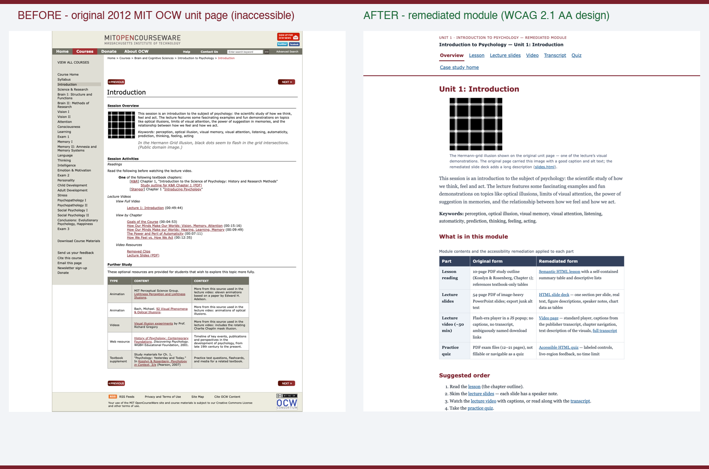

# Accessibility Remediation Case Study

A real, openly licensed university course unit — audited against WCAG 2.1 AA with automated **and** manual methods, remediated into accessible HTML, and documented with before/after evidence, a criterion-by-criterion conformance report, and a catalog-scale prioritization model.

**[Live case study](https://iwyusdaz.github.io/accessibility-remediation-case-study/)** · **[Remediated module](https://iwyusdaz.github.io/accessibility-remediation-case-study/module/)** · **[Conformance report](report/conformance-report.md)** · Role: Sole designer

**Evaluation status:** Automated accessibility testing and agent-based design reviews are complete. AI-simulated learner and review-panel evaluations are pending. No real learners have tested this yet. See evaluation/METHODS.md.

**Framing note:** "Lakeside State University" — a fictional US public university preparing for ADA Title II digital accessibility compliance — is the fictional client. The audited module is real, and its problems are real.

## The problem

The DOJ's ADA Title II rule requires state and local government entities — including public universities — to meet **WCAG 2.1 Level AA** for web content and mobile apps. The deadline for large covered public entities, originally April 24, 2026, was extended on April 20, 2026 to **April 26, 2027** (requirements unchanged; sources verified 2026-10-25: [Purdue](https://www.purdue.edu/innovativelearning/blog/2026/04/27/doj-extends-ada-title-ii-digital-accessibility-deadlines-what-instructors-should-do-now/), [CSU Stanislaus](https://www.csustan.edu/access-for-all/about-access-all-and-ati/title-ii-rule-digital-accessibility)). Institutions now face hundreds of courses to fix, and hiring managers increasingly expect instructional designers to show the craft: how you audit, fix, prioritize, and prevent (accessibility appeared in 41% of recent L&D postings, up from 27% — [Teamed, L&D Skills Landscape 2026](https://www.teamedforlearning.com/ld-skills-landscape-2026-whats-hot-whats-not/)).

This project shows both halves: **the craft** (one real module, fully audited and remediated with evidence) and **the program view** (how to scale to 300 courses without pretending the hours don't exist).

## Audience and context

- Higher-ed instructional designers and digital accessibility specialists piloting Title II remediation.
- Faculty authors who need a prevention guide, not a lecture.
- Portfolio reviewers assessing whether "accessibility" on a resume is real.

## My approach (analysis → design → build → evaluate)

1. **Select a real, openly licensed module** whose license permits adaptation: Unit 1 of *9.00SC Introduction to Psychology, Fall 2011* (Prof. John Gabrieli, MIT OpenCourseWare, **CC BY-NC-SA 3.0 US**, verified on the retrieved page). Retrieved 2026-10-25 from Internet Archive captures of the 2011–2012 site; the originals are preserved untouched in [`source/`](source/README.md) and rendered in [`docs/before/`](docs/before/).
2. **Audit, don't assume.** axe-core 4.11.1, Lighthouse 13.0.1, and pa11y 9.0.0 on every page; scripted keyboard, focus, 320 px-reflow and measured-contrast passes (Playwright); PDF tag-tree inspection. Every claim traces to a tool export or a scripted check ([methodology](audit/methodology.md)).
3. **Log before fixing.** 33 issues with WCAG criterion, severity, users affected, fix, effort ([issue log](audit/issue-log.md)) — including two findings I corrected against my own first assumptions (the "untagged table" in the PDF turned out to be a textbook reference; the reading PDF has no content figures at all).
4. **Rebuild every content type accessibly** ([remediated module](docs/module/index.html)): semantic HTML lesson, 54-slide HTML deck with speaker notes and chart data tables, video page with captions derived from the publisher transcript plus a full transcript and text description of the visuals, and an accessible quiz — on a contrast-tested palette.
5. **Verify and report.** Re-run everything on all remediated pages; criterion-by-criterion [conformance report](report/conformance-report.md) (explicitly not an official VPAT); [before/after evidence](report/before-after.md); [executive summary](report/executive-summary.md).
6. **Scale it honestly.** A [prioritization model](program/prioritization-model.md) scoring 10 fictional Lakeside State courses (Impact × Exposure ÷ Effort) using **published human benchmarks** (4–5 hours of caption correction per video hour — 3Play Media; up to ~1 hour per complex PDF page — WebAIM/Equidox; all accessed 2026-10-25) — never AI-agent processing time — plus a [remediation workflow](program/remediation-workflow.md) and a [faculty quick guide](docs/faculty-quick-guide.html).

## Key design decisions

1. **Convert PDFs and slides to HTML rather than tagging the PDFs.** Alternatives: Acrobat Pro tag repair, or shipping both. HTML reflows (the original failed 320 px reflow at a 952 px document width), works better with screen readers, is searchable, and is maintainable by faculty. The tagged PDFs are also *already tagged* — their real problems (junk alt text, chart data invisible to text readers) don't survive a round-trip through Acrobat anyway. Evidence: issue log I-20, I-24–I-28.
2. **Severity by task-blocking, not WCAG level alone.** A color contrast fail on a footnote and a keyboard-dead video player are both "AA" — they are not the same urgency. The log ranks critical (video unusable by deaf learners) above medium (state-less menu toggles), which is the order a remediation team actually works in.
3. **Captions from the publisher transcript, timings machine-aligned — and honestly labeled.** The video is ~50 minutes and lives at the publisher (too large for the repo; license permits linking). Its only embedded captions are uncorrected YouTube auto-captions; MIT's official human transcript has no timings. So the caption *text* is the publisher's, the *timings* are machine-aligned against the auto-caption skeleton, and both the video page and the conformance report say exactly that — the accuracy check stays **pending** until the STT word-error-rate check (`npm run eval:pending`) and a human timing spot-check run. Nothing is marked "fixed" on that evidence alone.
4. **No screen-reader theater.** VoiceOver automation (Guidepup) does not function on macOS 27 — verified. Rather than fabricate "VoiceOver tested," the repo ships a step-by-step [human VoiceOver protocol](evaluation/human-protocol/voiceover-protocol.md), a [paid-review invitation](evaluation/human-protocol/at-user-review-invite.md) for a daily AT user, and marks every screen-reader result **pending**. The demo video is labeled as scripted keyboard automation, not a screen reader demonstration.
5. **Prevention alongside remediation.** Remediation doesn't scale if new inaccessible content keeps arriving. The [faculty quick guide](docs/faculty-quick-guide.html) (10 rules) is treated as part of the deliverable, not an appendix.

## Evidence and evaluation

**What was measured** (all reproducible from the repo; exports in `audit/`):

- axe violations: **13 → 0** across audited pages; Lighthouse accessibility: **77/81/79 → 100** on all 8 pages; pa11y: 14 → 0.
- Issue log: 33 issues (3 critical, 11 high, 13 medium, 6 low) — all fixed, two corrected during verification for honesty.
- Scripted keyboard tasks: **11/11 pass** (skip link, radio groups, quiz feedback via live region, video chapter seeking, no traps).
- Reflow at 320 px: fail (952 px) → pass on all 9 site pages; measured contrast: 0 failures (palette ≥ 4.5:1, ratios documented in CSS).
- PDF tag-tree facts, not folklore: all six PDFs are tagged with titles and language — and still fail learners via junk/missing alt text and a brain diagram with no alternative.

**What this evidence can and cannot show**

- ✅ Can: issues found/fixed with tool + scripted evidence; keyboard/reflow/contrast quality of the rebuild; a benchmark-based scaling model; that the site itself passes the same audits.
- ❌ Cannot: claim conformance certification (the report is explicitly **not an official VPAT**); claim screen-reader testing (no human VoiceOver pass yet; automation broken on macOS 27); claim a daily-AT-user review (template ready, none run); claim verified caption accuracy (STT check pending); show learning outcomes.
- **What it changed:** verification caught real mistakes — a broken in-site link, `<main>` not receiving skip-link focus, an overflowing table at 320 px, an `<aside>` nesting violation, and two factually wrong issue-log entries — all fixed and recorded in [`evaluation/agent-review.md`](evaluation/agent-review.md).

The demo video below the fold on the [landing page](docs/index.html) is a scripted keyboard navigation of the module, captioned and transcribed, labeled as automation — not a screen reader demonstration.

## Accessibility

This site was audited with the same toolchain it teaches: axe-core 4.11.1 (0 violations on all 9 pages), Lighthouse 13.0.1 (100), pa11y 9.0.0 (0), plus scripted keyboard tests (11/11), 320 px reflow checks, and a contrast-tested palette (every pair ≥ 4.5:1; ratios in [`docs/module/css/module.css`](docs/module/css/module.css)). Every page has a skip link, landmarks, one content `h1`, and descriptive titles. Known limitations: no human screen-reader pass yet; caption accuracy check pending; see `STATUS.md`.

## Limitations (stated, not hidden)

- **No review by a person who uses assistive technology daily.** This is the strongest missing evidence; the [invitation template](evaluation/human-protocol/at-user-review-invite.md) treats it as paid work.
- **No VoiceOver automation evidence.** Guidepup does not work on macOS 27; the [human protocol](evaluation/human-protocol/voiceover-protocol.md) is ready but unrun.
- **Caption accuracy vs. audio is pending** (machine STT check via `npm run eval:pending` after keys are added to `.env`; human timing spot-check protocol ready). Caption text is the publisher's official transcript.
- **"Lakeside State University" is fictional** (labeled everywhere); the prioritization model's course list is fictional; the audited module and its issues are real.
- **Not an official VPAT; no conformance certification claimed.**
- **Same-model disclosure:** the agent review ran in the authoring context; a fresh-context reviewer pass is recommended follow-up.

## What I'd do differently / next steps

- Record a real audio description track (the text description is a stopgap).
- Run the paid AT-user review *before* publication, not after.
- Add MathML-ready patterns for math-heavy courses (explicitly out of scope here and flagged in the prioritization model).
- Wire the multi-model review panel (`MODEL_A/B/C`) once API keys are available.

## Tools used

axe-core 4.11.1 · Lighthouse 13.0.1 · pa11y 9.0.0 · Playwright 1.57.0 (scripted checks, screenshots, demo video) · pypdf/pymupdf (PDF tag inspection) · yt-dlp (caption timing skeleton) · GitHub Pages. Node 18+. All pinned in `package.json`.

## License and attribution

- Learning content: **CC BY-NC-SA 3.0 US** (matching the source), see [`LICENSE`](LICENSE).
- Code: **MIT**, see [`LICENSE-CODE`](LICENSE-CODE).
- Source module: *9.00SC Introduction to Psychology, Fall 2011*, Prof. John Gabrieli, MIT OpenCourseWare — full adaptation record in [`ATTRIBUTION.md`](ATTRIBUTION.md).
- Decision rationale: [`DECISIONS.md`](DECISIONS.md) · Status: [`STATUS.md`](STATUS.md) · Changelog: [`CHANGELOG.md`](CHANGELOG.md).

## Contact

[LinkedIn] · [Email]

---

*Built with AI assistance (disclosed per portfolio standards): the module conversion, audits, and write-up were produced with an AI agent, and every claim is reproducible from this repository. The course content itself is MIT OpenCourseWare's, © the original authors, used under CC BY-NC-SA 3.0 US.*
