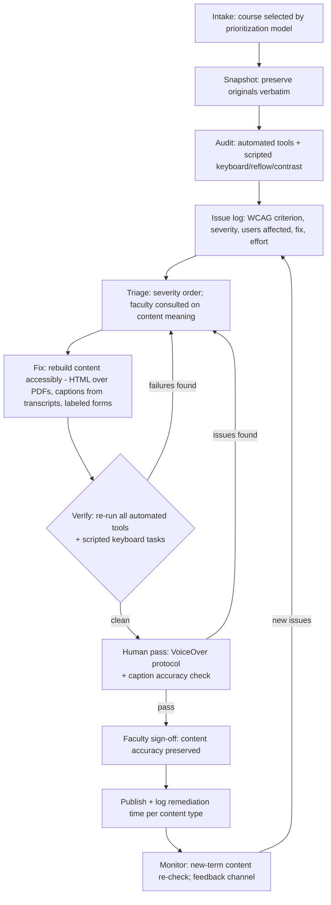

# Remediation workflow: intake → audit → fix → verify → sign-off

The repeatable pipeline used for the pilot module in this repository, ready to
run per course at catalog scale.

## Diagram

*(If your Markdown viewer does not render Mermaid, the text below is the same
process.)*

## Text description

1. **Intake.** The course arrives from the [prioritization model](prioritization-model.md)
   with its score and effort estimate. The disability-services office flags any
   active accommodation requests, which jump the queue.
2. **Snapshot.** Originals are preserved verbatim (in this repo: `source/` and
   a renderable "before" copy). Nothing is fixed in place before evidence is
   captured: automated tool exports, screenshots, keyboard logs.
3. **Audit.** axe-core + Lighthouse + a second CLI engine (pa11y) on every
   page; scripted keyboard tab-through, focus-visibility check, 320 px reflow,
   and measured color contrast; PDF tag-tree inspection; media availability
   check (captions? transcript? audio description?). Output: an issue log with
   WCAG criterion, severity, users affected, proposed fix, and effort (S/M/L).
4. **Triage.** Order by severity (task-blocking first), batch by content type,
   and loop in the faculty author for anything that touches meaning (alt text
   for disciplinary images, quiz wording, plain-language edits).
5. **Fix.** Prefer rebuilding to patching: HTML over PDF, real text over images
   of text, captions derived from official transcripts, semantic tables, native
   form controls. Each fix is recorded against its issue ID.
6. **Verify.** Re-run every automated tool and scripted check; re-run the
   keyboard task tests; confirm zero critical/serious issues (or documented,
   accepted exceptions).
7. **Human pass.** A human runs the screen-reader protocol
   (`evaluation/human-protocol/voiceover-protocol.md`) and the caption-accuracy
   check (`evaluation/human-protocol/caption-accuracy-check.md`); ideally a
   paid reviewer who uses assistive technology daily reviews the result.
8. **Faculty sign-off.** The author confirms the remediated version still
   teaches the same content — accessibility work must never silently change
   meaning.
9. **Publish + measure.** Deploy, log time-per-content-type (it feeds the next
   prioritization round), and archive the before/after evidence.
10. **Monitor.** Each new term, re-check new content; keep a feedback channel
    for students and instructors; re-audit on any template change.

## Roles at scale

| Role | Owns |
|---|---|
| Accessibility specialist | Audit, triage, verification, issue log |
| Instructional designer | Rebuild (HTML conversion, quiz, structure), faculty support |
| Media services / vendor | Captioning at benchmark rates; audio description |
| Faculty author | Content meaning, sign-off, prevention (quick guide) |
| Disability services | Accommodation queue, severity overrides |
| Program manager | Prioritization model, capacity plan, reporting |
